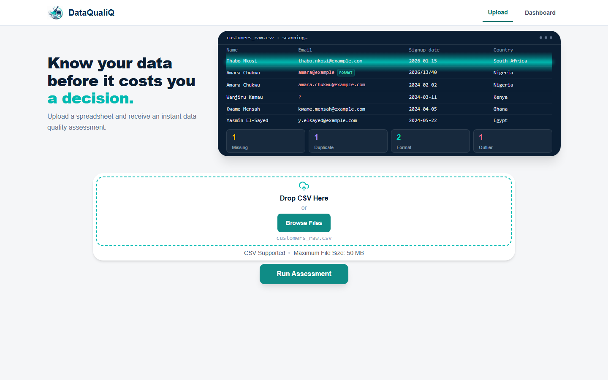
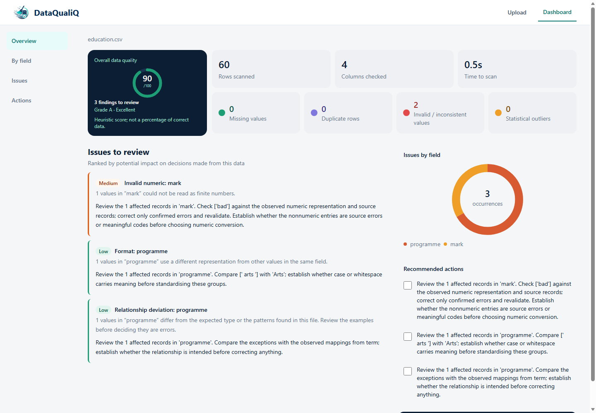
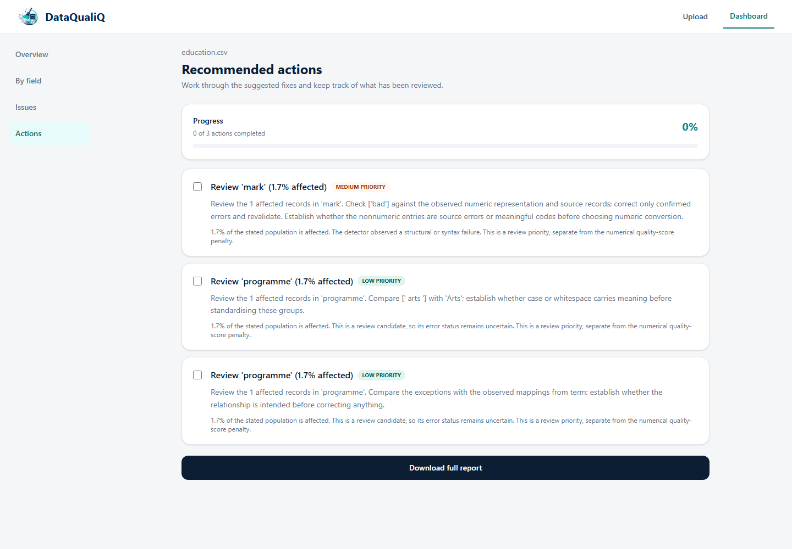
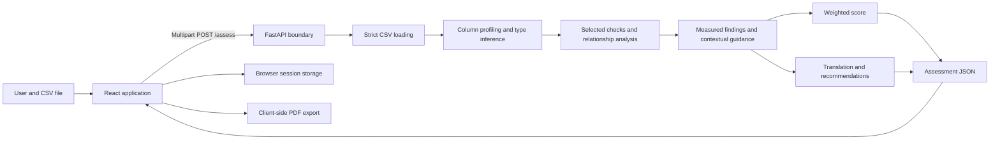
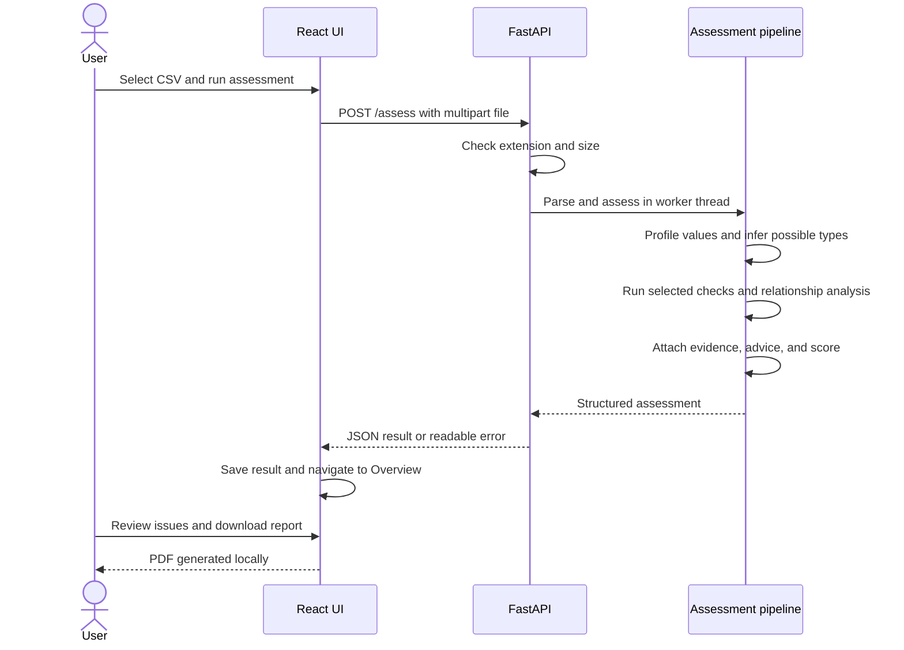

<div align="center">


# DataQualiQ

### Know your data before it costs you a decision.

**An explainable data quality assessment prototype that turns CSV problems into a practical review plan.**

React · FastAPI · Python · pandas · NumPy · Tailwind CSS

[](https://github.com/NokubongaVee/DataQualiQ/actions/workflows/ci.yml)

[Product tour](#product-tour) · [Architecture](#system-architecture) · [Run locally](#run-locally) · [Progress](#progress-and-roadmap) · [Testing](#testing-and-evaluation)

</div>

## The project in one minute

DataQualiQ helps people understand whether a spreadsheet needs attention before they use it for analysis, reporting, or operational decisions. Upload a CSV, inspect the quality overview, review affected fields, and work through recommendations ranked by review priority. A downloadable PDF makes the assessment easier to share.

The project explores a practical question: **can automated data quality checks become understandable decision support for users who are not data engineers?**

The answer being developed here combines measured evidence with conservative interpretation. The system detects missing values, duplicate rows, invalid formats, inconsistent representations, and unusual values; it also examines field meaning and relationships. It then explains what needs review and suggests a next step. It does not silently repair or overwrite the input.

**Author:** [Victoria Nokubonga Mnisi](https://github.com/NokubongaVee)  
**Academic context:** Mini-capstone in Data Engineering, Department of Computer Science & Information Technology, Sol Plaatje University.  
**Project title:** *Design and Development of an Intelligent Data Quality Assessment System for Decision Support.*  
**Status:** Working local prototype under iterative development and evaluation. This repository is a portfolio of implemented engineering work, not a claim of production readiness.

## Why this matters

A dataset can look usable while containing gaps that change the conclusions drawn from it. A missing amount can distort a total. A repeated row can inflate a count. Different spellings of the same category can split a report into misleading groups. An applicant record without contact details can delay follow-up.

Traditional validation output often stops at a technical error message. DataQualiQ aims to close the gap between **finding a problem** and **understanding what to review next**.

The intended users include small-business data owners, analysts, students, and operational decision-makers who need a first-pass assessment without writing validation code.

## Product tour

### 1. Upload and assess

The landing page combines a CSV upload area with an animated illustrative scan preview. Users can browse for a file or drop one onto the page and run an assessment. The preview is a demonstration, not live output from an uploaded file.



### 2. Understand the results

The overview presents the assessment score, record and field counts, issue summaries, and priority-ranked reviews. The field view helps users locate concentrations of problems. The issues view keeps the interface focused on the severity badge, title, description, and suggested action.



### 3. Work through recommendations

The Actions page provides a review checklist and a PDF export. Checking an action records progress in the current page state; it does not change the uploaded dataset or persist a completed audit history.



Screenshots use demonstration data. See [the image notes](docs/images/README.md) for capture details and scope.

## What is implemented

| Capability | Current behavior |
| --- | --- |
| CSV ingestion | Uploads up to 50 MiB; rejects empty files, duplicate/blank headers, malformed rows, and unsupported file extensions. |
| CSV compatibility | Handles comma, semicolon, tab, and pipe separators; UTF-8/BOM, UTF-16 BOM, and a CP1252 fallback. |
| Value preservation | Retains strings during ingestion, including leading zeros and original representations. |
| Completeness | Identifies blanks and recognised null markers; reports affected row indices and counts. |
| Duplication | Finds exact repeated rows and separately reviews repeated candidate identifiers. |
| Validity and consistency | Selects checks for observed representations such as numeric values, dates, email addresses, phone numbers, and categories. |
| Statistical review | Uses distribution-based checks to flag unusual numeric observations for review. |
| Field interpretation | Profiles values before selecting checks; records uncertainty and contradictions instead of relying only on a header. |
| Relationship analysis | Examines co-missingness, missingness concentrations, repeated-key conflicts, and supported mappings within bounded analysis limits. |
| Contextual recommendations | Adds field- and recruitment-aware advice, including alternative contact coverage and conservative handling of missing ages. |
| Priority | Uses red/high, orange/medium, and green/low review badges. Priority is separate from the score penalty. |
| Reporting | Five views: Upload, Overview, Issues, By field, and Actions; client-generated PDF assessment report. |
| Browser state | Stores assessment results and the visited page in session storage; refreshing Upload does not redirect to saved results. |
| Responsive interface | Adapts navigation, wrapping, and layout for smaller screens while keeping desktop content centered. |

## What “intelligent” means in this prototype

DataQualiQ uses **explainable rules, profiling, statistical checks, and bounded contextual inference**. It does not use a trained predictive model, an LLM, or an external AI API.

The system separates three questions:

1. **What can be measured?** For example, six records have no email value.
2. **What might the field mean?** Column names and observed values suggest a possible contact field.
3. **What should someone review?** Check the source records and prioritise entries without an alternative contact channel.

This distinction is intentional. A rare value is not automatically wrong; a header is not proof of business meaning; and a populated phone number is not proof that someone can be reached.

### Example: applicant data

When applicant fields and recruitment-related fields appear together, the system can infer a possible recruitment context. For a missing contact finding, it checks other recognised contact columns in the affected records.

| Observation | Interpretation and suggested response |
| --- | --- |
| Six of ten applicants have missing email and no populated alternative contact field | High review priority under the current contact-coverage rule; interview invitations or application updates may be delayed. Recover verified details from the original forms. |
| The same six applicants have another populated contact field | Medium priority in this example; check whether the alternative is usable before treating the applicant as unreachable. |
| Eight of ten applicants have missing ages, with no age-dependent fields detected | Low priority by default; confirm whether age is required for the actual purpose instead of assuming every missing age is critical. |
| An age-group or other recognised age-dependent field is present | Medium priority for review; confirm the requirement. The system does not invent eligibility criteria. |

These examples are covered by regression tests. They are scoped heuristics, not universal business rules. Unfamiliar workflows still need human interpretation.

## System architecture



There is no application database in the current design. Uploaded bytes are read by the API and assessed in memory. The frontend stores the returned result in browser session storage and generates the PDF locally. The backend offloads assessment work from the asynchronous request handler into a worker thread.

### Assessment lifecycle



For module responsibilities, design tradeoffs, and data handling, see [Architecture](docs/ARCHITECTURE.md).

## Engineering decisions worth exploring

- **Keep ingestion faithful.** Treating CSV values as strings avoids losing leading zeros or erasing the representation that a format check needs to inspect.
- **Separate detectors from presentation.** Detection, evidence enrichment, scoring, and recommendation rendering live in different modules. The frontend consumes a structured response rather than implementing its own quality rules.
- **Preserve uncertainty.** Outliers and relationship deviations are review candidates; plausible context is not presented as an established business requirement.
- **Separate score from priority.** A familiar score supports orientation, while contextual review priority helps choose what to inspect first. New semantic and relationship review candidates do not silently acquire legacy score penalties.
- **Avoid inflated displayed counts.** Frontend utilities deduplicate overlapping cell findings where appropriate, while keeping duplicate-row counts distinct.
- **Test inconvenient inputs.** Regression coverage includes anonymous and misleading headers, alternate encodings, malformed CSV, extreme numeric magnitudes, and conflicting relationships.
- **Keep correction under human control.** The prototype recommends actions but never automatically fills, deletes, merges, or overwrites source records.

## Repository layout

```text
DataQualiQ/
├── README.md
├── .gitignore
├── .github/workflows/ci.yml
├── docs/
│   ├── ARCHITECTURE.md
│   ├── EVALUATION.md
│   ├── images/                 # Actual application screenshots
│   └── history/                # Earlier engineering notes, labelled historical
├── backend/
│   ├── main.py                # API boundary and upload checks
│   ├── pipeline.py            # Assessment orchestration
│   ├── csv_loading.py
│   ├── profiling.py
│   ├── type_inference.py
│   ├── check_selection.py
│   ├── generic_checks.py
│   ├── validity_checks.py
│   ├── anomaly_detection.py
│   ├── relationships.py
│   ├── finding_evidence.py
│   ├── contextual_guidance.py
│   ├── scoring.py
│   ├── translator.py
│   ├── recommendation_policy.py
│   ├── test_*.py
│   └── sample_data/            # Public demonstration fixtures
└── frontend/
    ├── src/components/
    ├── src/pages/
    ├── src/utils/
    ├── public/
    ├── package.json
    └── package-lock.json
```

The application lives in two sibling folders: `backend` for the assessment API and `frontend` for the web interface. Scripts and CI use this structure. Dependencies, virtual environments, generated builds, private uploads, and local tool configuration are excluded from Git.

## Run locally

Use **Python 3.13** and **Node.js 24** to match the validation environment. Start the backend and frontend in separate terminals. The current frontend calls `http://localhost:8000`; Vite should run on port 5173 (or the allowed 5174 fallback).

### Backend — Windows PowerShell

```powershell
cd backend
py -3.13 -m venv venv
.\venv\Scripts\python.exe -m pip install -r requirements.txt
.\venv\Scripts\python.exe -m uvicorn main:app --host 127.0.0.1 --port 8000
```

### Backend — macOS / Linux

```bash
cd backend
python3.13 -m venv venv
./venv/bin/python -m pip install -r requirements.txt
./venv/bin/python -m uvicorn main:app --host 127.0.0.1 --port 8000
```

### Frontend

```bash
cd frontend
npm ci
npm run dev -- --host localhost --port 5173
```

On Windows, use `npm.cmd` if PowerShell blocks the `npm.ps1` wrapper. Open `http://localhost:5173`, choose a CSV from `backend/sample_data`, and select **Run Assessment**. API documentation is available at `http://127.0.0.1:8000/docs` while the backend is running.

### API surface

| Method | Route | Purpose |
| --- | --- | --- |
| GET | `/` | Service information |
| GET | `/health` | Health response |
| POST | `/assess` | Assess a multipart CSV upload under the `file` field |
| POST | `/assess-with-sample` | Assess the bundled customer demonstration CSV |

```bash
curl -F "file=@backend/sample_data/generalisation/education.csv" http://127.0.0.1:8000/assess
```

The response contains dataset dimensions, column profiles, inferred context, relationships, raw findings, translated reviews, recommendations, and score details.

## Testing and evaluation

### Run the automated checks

```powershell
cd backend
.\venv\Scripts\python.exe -m unittest discover -v
```

```bash
cd frontend
npm run lint
npm run build
node --test src/components/IssueCard.test.js src/utils/affectedValues.test.js src/utils/reviewOrder.test.js src/utils/navigation.test.js
```

Use `./venv/bin/python` for the backend command on macOS/Linux. GitHub Actions runs backend tests and frontend tests, lint, and build on pushes and pull requests.

The publication validation record is in [Evaluation](docs/EVALUATION.md). Automated regression tests establish specific behaviors; they are not a substitute for an independently labelled accuracy benchmark.

### Capstone success target

The project targets **at least 90% agreement with manual reviews across at least three datasets**. This is an evaluation objective, not a completed accuracy claim. A repeatable manual-review protocol, per-dataset precision/recall, and an error analysis are planned deliverables.

## Progress and roadmap

| Workstream | Status | Evidence / next step |
| --- | --- | --- |
| Problem definition and scope | Defined | Decision support for CSV quality; original-data correction is out of scope. |
| Upload-to-assessment flow | Implemented | FastAPI upload boundary, strict CSV parsing, React results flow. |
| Core checks and profiling | Implemented | Dedicated detector modules and regression tests. |
| Adaptive interpretation | Implemented, bounded | Value profiling, uncertainty, relationship checks, limited contextual advice. |
| Dashboard and report | Implemented | Overview, field review, issues, action checklist, PDF. |
| Responsive interface | Implemented and iterated | Browser smoke harness and screenshots; physical-device coverage is limited. |
| Regression testing | Implemented | Backend and frontend suites; CI configuration included. |
| Manual benchmark | Pending | Label at least three datasets; report agreement and false positives. |
| User evaluation | Pending | Observe nontechnical users; assess clarity and decision usefulness. |
| Public hosted demo | Not deployed | Requires deployment configuration and appropriate service protections. |

Next improvements include allowing users to confirm a dataset's purpose and required fields, broadening context rules with tests, improving score calibration, reducing the frontend bundle size, and strengthening deployment configuration.

## Boundaries and limitations

- The score is a weighted heuristic, **not the percentage of correct data** or proof of fitness for a decision.
- Field and domain interpretation can be wrong. Business requirements cannot always be recovered from a CSV.
- Format validity does not establish real-world truth or contact deliverability.
- Statistical outliers can be legitimate; relationship analysis is bounded and may be sampled.
- Very small screens and browser zoom may require normal page scrolling.
- Browser session storage is not a database; large assessment results may exceed its quota. Action completion is not durable.
- The local prototype does not implement authentication, multi-user storage, rate limiting, or a production deployment model. CSV-only ingestion and the current localhost API configuration are intentional prototype constraints.
- The production build currently reports a large-chunk warning. Code splitting is future optimisation work.

## Data handling and public examples

Use synthetic or appropriately authorised data when trying the project. The backend does not intentionally persist uploaded CSVs to an application database, but assessment results and PDF reports can contain source values. Results remain in the browser's session storage until removed or the session ends.

The public customer demo uses fictional identities and reserved example-domain addresses. Other sample files contain generated identifiers and controlled values. The illustrative landing preview is not a real assessment. Academic identifiers, private uploads, local credentials, dependency folders, and development caches are not part of this publication.

## About the work

This capstone brings together data engineering, API design, frontend development, explainability, testing, and iterative user feedback. Its central design commitment is to make automated findings useful without overstating what the system knows.

For a code review, start with `pipeline.py`, follow a finding through `finding_evidence.py` and `contextual_guidance.py`, then inspect `IssueCard.jsx` and the regression tests. Historical development notes are available under `docs/history`; the current README and evaluation record take precedence where the interface has evolved.
