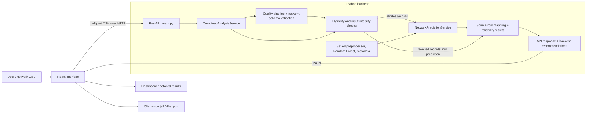
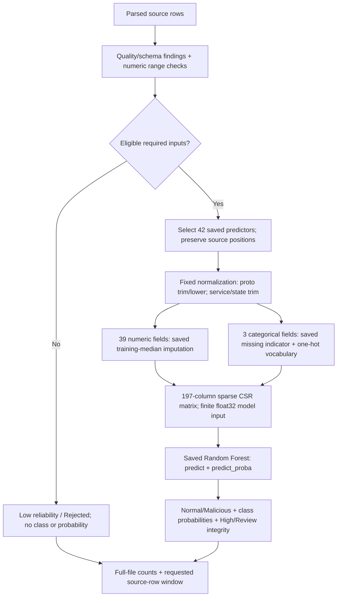

<div align="center">


# DataQualiQ

### Assess the input. Classify the traffic. Explain what needs review.

**Data quality-aware network intrusion analysis**

Python ? FastAPI ? scikit-learn ? React ? Vite

[](https://github.com/NokubongaVee/DataQualiQ/actions/workflows/ci.yml)

[Run locally](#run-locally) ? [Architecture](#system-architecture) ? [ML pipeline](#machine-learning-pipeline) ? [API](#api-overview) ? [Tests](#testing)

</div>

## Overview

DataQualiQ is a Computer Science and cybersecurity decision-support prototype for analysing uploaded network-traffic CSVs. It assesses data quality, applies a saved Random Forest to compatible records, and explains which predictions need input review or independent security investigation. The React interface presents dataset summaries, record-level evidence, backend recommendations, and a downloadable PDF.

Network classifiers consume data that may contain missing cells, invalid values, unfamiliar categories, or inconsistent representations. A prediction alone does not explain whether its inputs were suitable. DataQualiQ brings schema validation, reproducible preprocessing, binary classification, and evidence-based decision support into one workflow.

The implementation combines software engineering, statistical profiling, supervised machine learning, API design, and security analysis. It analyses exported traffic records; it does not capture packets, monitor a live network, or automatically block traffic.

### Three signals, three meanings

| Signal | Question answered | Meaning |
|---|---|---|
| **Data-quality score** | What did the implemented quality checks find? | A heuristic weighted-penalty score and grade; not a percentage of correct data |
| **Predicted-class probability** | How strongly did the saved model support its chosen class? | A model estimate; not calibrated certainty |
| **Input reliability** | Could this record be predicted under the implemented integrity policy? | High, Review, or Low; separate from probability and classification correctness |

A malicious prediction with High input reliability still needs security investigation. A normal prediction with Review reliability still needs input review.

## Technologies

| Layer | Implementation |
|---|---|
| Frontend | React 19, React DOM, JavaScript/JSX, Vite 8 |
| Interface and reports | Tailwind CSS 4 with custom CSS, Lucide icons, react-dropzone, jsPDF |
| API | Python 3.13, FastAPI, Uvicorn, python-multipart |
| Data processing | pandas, NumPy, SciPy sparse matrices |
| Machine learning | scikit-learn RandomForestClassifier, SimpleImputer, OneHotEncoder |
| Persistence | Trusted local joblib model/preprocessor files plus JSON metadata |
| Verification | Python unittest, Node test runner, ESLint, optional headless Edge audits, GitHub Actions |

Backend versions are pinned in [requirements.txt](backend/requirements.txt); frontend dependencies are locked in [package-lock.json](frontend/package-lock.json). There is no database, Docker/Compose setup, separate model server, or background job queue in the current implementation.

## System architecture

The normal upload path uses one React interface and one FastAPI process. The quality pipeline assesses the source values; the combined service connects its findings to prediction eligibility and source-row positions. Saved preprocessing and classification run inside the backend process.



### Backend responsibilities

| Code | Responsibility |
|---|---|
| [main.py](backend/main.py) | Defines every API route, validates upload size/type, closes uploads, and delegates expensive upload processing to a thread pool |
| [csv_loading.py](backend/csv_loading.py) | Strict CSV decoding/parsing; rejects malformed rows, binary content, and blank/duplicate headers while preserving source cell spellings |
| [pipeline.py](backend/pipeline.py) | Coordinates profiling, check selection, relationships, evidence, contextual guidance, schema validation, scoring, and translated quality advice |
| `profiling.py`, `type_inference.py`, `dataset_context.py`, `check_selection.py` | Infer field evidence and context, then choose applicable quality checks |
| `generic_checks.py`, `validity_checks.py`, `anomaly_detection.py`, `relationships.py` | Detect missingness, duplicates, syntax/format issues, analytical anomalies, and relationship candidates |
| `finding_categories.py`, `finding_evidence.py`, `scoring.py` | Categorize and explain findings; calculate the heuristic quality score |
| `contextual_guidance.py`, `recommendation_policy.py`, `translator.py`, `plain_language.py` | Produce evidence-based quality explanations and advice for the independent assessment contract |
| [domains/network](backend/domains/network) | Explicit structural schema, dataset-specific field definitions, and validators |
| [preprocessing](backend/preprocessing) | Conservative, explicit preparation policies and provenance; separate from read-only assessment |
| [ml/preprocessing.py](backend/ml/preprocessing.py) | Training-fitted numeric imputation, categorical encoding, fixed normalization, and sparse feature construction |
| [ml/artifacts.py](backend/ml/artifacts.py) | Verify and load trusted model bundles; explicitly rebuild/persist them when requested |
| [ml/prediction.py](backend/ml/prediction.py) | Lazy artifact cache, inference lock, sparse batches, class/probability validation, and bounded prediction records |
| [ml/combined_analysis.py](backend/ml/combined_analysis.py) | Reject incompatible rows, mark review conditions, join quality evidence to predictions, and compute full-file reliability/class counts |
| [ml/analysis_response.py](backend/ml/analysis_response.py) | Assemble the final JSON contract, expose saved official evaluation, and generate network-analysis recommendations |

The standalone `/assess` endpoint does not invoke ML preprocessing or classification. `/predict-network` performs saved inference without the quality/reliability orchestration. The frontend's normal upload action calls `/analyze-network`.

## End-to-end workflow

```mermaid
sequenceDiagram
    actor User
    participant UI as UploadPage / API client
    participant API as FastAPI main.py
    participant Combined as CombinedAnalysisService
    participant Quality as Quality pipeline
    participant Predictor as NetworkPredictionService
    participant Format as analysis_response.py
    participant Views as App / result views

    User->>UI: Select CSV and analyse
    UI->>UI: Validate file; guard duplicate/stale requests
    UI->>API: POST /analyze-network?offset=0&limit=100
    API->>API: Check upload; parse CSV in thread-pool work
    API->>Combined: DataFrame + filename + requested window
    Combined->>Predictor: Load/validate saved artifacts if not cached
    Combined->>Quality: Assess raw rows with saved network schema
    Quality-->>Combined: Findings, source positions, score and grade
    Combined->>Combined: Check eligibility, missingness and unseen categories
    loop Inference batches of at most 4096 source rows
        Combined->>Predictor: Eligible rows grouped as High / Review
        Predictor->>Predictor: Saved transform, predict and predict_proba
        Predictor-->>Combined: Counts, probabilities, bounded records
    end
    Combined->>Combined: Restore source positions; add Low rejected rows
    Combined-->>API: Full-file summaries and bounded record evidence
    API->>Format: Validate saved evaluation; assemble recommendations
    Format-->>API: Combined response
    API-->>UI: JSON
    UI->>Views: Validate response; store active result in React memory
    Views-->>User: Dashboard, details, filters and PDF export
```

Missing required columns or invalid uploads fail the request. In the combined endpoint, structurally invalid required values reject the affected records individually; valid records can still be classified. Record indices remain zero-based positions in the original CSV data rows, excluding the header; the interface displays human-facing record numbers starting at one.

The service calculates full-file summaries even when returning only a small record window. There is no reusable analysis ID: requesting a different window requires uploading and analysing the file again.

## Machine-learning pipeline

### What is actually served

The loader reads these files from [backend/models](backend/models):

| File | Role |
|---|---|
| `intrusion_model.joblib` | Fitted RandomForestClassifier |
| `preprocessor.joblib` | Fitted `ml.preprocessing.NetworkMLPreprocessor` |
| `model_metadata.json` | Required features, encoded order, learned categories/medians, schema, parameters, evaluation, version and checksums |
| `selection_reference.json` | Candidate evaluation and selection inputs used by the explicit artifact-reproduction command; not required for routine inference |

The saved forest has **100 trees**, maximum depth **20**, minimum split **10**, minimum leaf **2**, sqrt feature sampling, bootstrap enabled, and seed **42**. The bundle records **175,341 training rows**, **42 raw predictors**, and **197 encoded features**. Class `0` is Normal; class `1` is Malicious.

Artifacts are loaded lazily and cached per prediction-service instance. Loading verifies the artifact version, exact scikit-learn version, SHA-256 checksums, expected feature information, estimator parameters/width, and class mapping. A lock protects preprocessing audits and inference. Only trusted local joblib bundles should be loaded; checksum matching does not establish that an untrusted bundle is safe.

### Inference, without fitting



Numeric missing values use training-fitted medians. Missing categorical values use the reserved `__dataqualiq_missing__` indicator. Unseen categories use the saved encoder's all-zero category block and trigger Review; uploads never extend the vocabulary. Protocol names are trimmed/lowercased; service and state are trimmed with case preserved. The legitimate service value `-` is not treated as missing.

The transform produces a sparse matrix in the saved feature order. Inference uses batches of at most **4,096**, validates finite float32-representable inputs, and calls the estimator's existing `predict` and `predict_proba` methods. The reported probability is the probability of the predicted class. Deterministic sequential tree accumulation is used without changing the saved forest parameters.

Inference performs **no fitting, retraining, scaling, outlier clipping, or duplicate removal**. Missing values that can be handled are distinct from invalid values that must be rejected. The combined service determines eligibility and review conditions before prediction, then attaches the corresponding reliability and reasons to the source-mapped result.

### Offline training and evaluation

[ml/prepare.py](backend/ml/prepare.py) prepares the official train/test partitions and fits preprocessing on usable training data only. [ml/training.py](backend/ml/training.py) trains Decision Tree and Random Forest candidates. [ml/evaluation.py](backend/ml/evaluation.py) evaluates the same labelled testing population and applies its declared recall-weighted F2 comparison, including a near-equivalence rule that prefers lower practical complexity.

The packaged Random Forest evaluation covers 82,332 testing records:

| Accuracy | Precision | Malicious recall | F1 | False positives | False negatives |
|---:|---:|---:|---:|---:|---:|
| 86.4111% | 80.6874% | 99.0206% | 88.9188% | 10,744 | 444 |

These values come from the saved bundle's evaluation metadata, not from whichever CSV is currently uploaded. Selection used the testing split, so the selected model's metrics are not a fresh independent estimate of the winner. Probability calibration and cross-network generalization are not established.

## Input requirements

Upload a nonempty `.csv` of at most **50 MiB**. The parser supports comma, semicolon, tab, and pipe separators, with UTF-8/BOM, UTF-16/BOM, and a Windows-1252 fallback. Headers must be nonempty and unique, and every data row must match the header width. Cell strings retain leading zeros, whitespace, missing markers, and original numeric spellings until an explicit preparation step interprets them.

Network prediction requires these exact 42 feature names; column order is taken from the saved preprocessor:

```text
dur, proto, service, state, spkts, dpkts, sbytes, dbytes, rate,
sttl, dttl, sload, dload, sloss, dloss, sinpkt, dinpkt, sjit, djit,
swin, stcpb, dtcpb, dwin, tcprtt, synack, ackdat, smean, dmean,
trans_depth, response_body_len, ct_srv_src, ct_state_ttl, ct_dst_ltm,
ct_src_dport_ltm, ct_dst_sport_ltm, ct_dst_src_ltm, is_ftp_login,
ct_ftp_cmd, ct_flw_http_mthd, ct_src_ltm, ct_srv_dst, is_sm_ips_ports
```

`proto`, `service`, and `state` are categorical; the other 39 predictors use numeric handling. `id`, `label`, and `attack_cat` are excluded from predictive features and are not required for inference. Other extra columns are not supplied to the classifier, although quality assessment can inspect them. The saved schema defines structural constraints; for example, counts must be nonnegative integers and durations must be nonnegative. It does not reject an observation merely because it is statistically extreme or its category is rare.

Blank cells and case-insensitive `na`, `n/a`, `null`, `nan`, and `none` are recognized as missing. The [model metadata](backend/models/model_metadata.json) is the authoritative feature/schema reference. The included official testing CSV is a compatible upload example.

## Reliability and recommendations

| Reliability | Implemented meaning | Prediction |
|---|---|---|
| **High** | No qualifying predictive-input integrity issue found | Class and probabilities available |
| **Review** | Handled missing predictive values, unseen categories, or relevant quality/data-error findings | Class and probabilities available with reasons |
| **Low** | Required values are structurally invalid, outside the supported numeric representation, or collide with reserved preprocessing values | `Rejected`; class and probabilities are null |

Missing required **columns** reject the request; missing **cells** can instead be handled by the saved preprocessing and marked Review. Ancillary-field findings can affect the quality assessment without invalidating prediction. Analytical/IQR anomalies and preserved duplicates do not, by themselves, reduce input reliability under the default policy. Analytical and uncertain review candidates also do not reduce the quality score.

Network recommendations are created in `ml/analysis_response.py` from full-file evidence and exact class/reliability counts. They call for human review of malicious predictions with integrity issues, investigation of predicted malicious traffic, correction/reanalysis of rejected inputs, and contextual review of missingness, invalid values, anomalies, and duplicates. React displays these recommendations; it does not produce a competing classification or recommendation model.

## API overview

All routes live in [backend/main.py](backend/main.py). Interactive OpenAPI documentation is available at `/docs` while the backend is running.

| Method | Route | Purpose |
|---|---|---|
| GET | `/` | Service status and endpoint summary |
| GET | `/health` | Process health; does not load or validate the model bundle |
| POST | `/assess` | Independent quality assessment; optional `network_schema` JSON multipart field |
| POST | `/assess-with-sample` | Assess the included customer sample without uploading a file |
| POST | `/predict-network` | Saved-model prediction without the quality/reliability orchestration |
| POST | `/analyze-network` | Combined quality, classification, reliability and recommendations |

Upload routes accept multipart field `file`. Both network endpoints accept `offset >= 0` and `0 <= limit <= 1000`; defaults are `offset=0`, `limit=100`. A zero limit requests summaries without record details. The standalone prediction endpoint reports invalid feature input as a request error; per-record rejection is implemented by the combined endpoint.

The combined JSON contains:

```text
response
├── filename            uploaded filename
??? data_quality        score, grade, measured groups, schema audit and warnings
??? intrusion_summary   full-file predicted/rejected/class counts and probability
??? model_performance   saved official test metrics and provenance
??? reliability_summary full-file High/Review/Low counts and class cross-counts
??? records             requested source-row window with reasons and evidence
??? pagination          offset, limit, totals, next_offset and has_more
??? recommendations     backend priority, message, reason and affected count
```

Malformed/oversized uploads return 400; missing features and invalid network/query inputs use 422; missing/incompatible artifacts or evaluation metadata use 503. Unexpected failures return safe error messages while backend logs record the exception. Record evidence is bounded to ten findings per record and 1,000 findings per returned page, with truncation indicators.

Example from the repository root, with the backend running:

```powershell
curl.exe -F "file=@data/UNSW_NB15_testing-set.csv" "http://127.0.0.1:8000/analyze-network?offset=0&limit=100"
```

## Frontend architecture and features

[App.jsx](frontend/src/App.jsx) owns the active result, summary, and selected page through React hooks. Navigation uses a page-state enum in [navigation.js](frontend/src/utils/navigation.js), not React Router or URL routes.

| View | Main implementation | Features |
|---|---|---|
| Upload & Analyse | `pages/UploadPage.jsx`, `components/Dropzone.jsx` | CSV validation, disabled controls, synchronous duplicate-submit guard, AbortController and stale-response protection |
| Dashboard | `pages/OverviewPage.jsx`, `components/NetworkDashboard.jsx` | Full-file traffic/quality summaries, official model performance, reliability, record preview and recommendations |
| Data Quality | `pages/AnalysisPages.jsx`, `components/NetworkDetailPages.jsx` | Quality groups, affected-record/occurrence counts, field details and warnings |
| Intrusion Detection | `components/NetworkDetailPages.jsx` | Upload classifications alongside clearly separated official evaluation/confusion counts |
| Results | `components/NetworkDetailPages.jsx`, `components/RecordAttention.jsx` | Returned-record filters, probabilities, input-integrity reasons, evidence and rejection reasons |
| Reports | `components/NetworkDetailPages.jsx`, `utils/downloadNetworkPdf.js` | Client-side combined PDF with bounded evidence and up to 20 important records from the returned window |

[api/networkAnalysis.js](frontend/src/api/networkAnalysis.js) owns multipart submission and actionable API errors. [utils/networkAnalysis.js](frontend/src/utils/networkAnalysis.js) validates the network response and persists only an allowlisted summary. Processing labels advance on a client timer; they describe approximate stages, not live backend progress.

Full results remain in React memory across navigation. Guarded session-storage writes retain a small summary and current page; quota/storage failures cannot invalidate a successful analysis. Refresh loses detailed records and PDF data and displays a no-active-analysis state with any historical summary clearly distinguished. Filters apply to the returned page; the frontend does not automatically fetch later windows.

PDF generation runs locally through jsPDF. It includes full-file summaries, saved evaluation provenance, input-integrity reasons and backend recommendations, with a bounded important-record preview. It is not an export of every predicted row. Compatible generic-assessment renderers remain for the independent quality response contract; the normal upload UI uses the combined network endpoint.

## Project structure

```text
DataQualiQ/
??? backend/
?   ??? main.py                    API routes
?   ??? pipeline.py                Quality orchestration
?   ??? csv_loading.py             Strict, shared CSV parser
?   ??? domains/network/           Explicit schemas and structural validation
?   ??? preprocessing/             Conservative preparation and provenance
?   ??? ml/                        Preparation, training, evaluation and inference
?   ??? models/                    Saved bundle and selection reference
?   ??? experiments/               Offline data-quality robustness checks
?   ??? sample_data/               Public examples and regression inputs
?   ??? test_data/                 Shared fixtures, responses and reload fingerprints
?   ??? test_*.py                  Backend regression tests
?   ??? requirements.txt           Pinned Python dependencies
??? frontend/
?   ??? src/api/                   HTTP client
?   ??? src/pages/                 Page-level views
?   ??? src/components/            Dashboard, details, evidence and navigation UI
?   ??? src/utils/                 Contracts, storage, presentation and PDF helpers
?   ??? public/                    Static assets
?   ??? *.mjs                      Browser/rendering audits
?   ??? package.json               Run, test and build commands
?   ??? package-lock.json          Locked frontend dependencies
?   ??? .env.example               Public API-base configuration example
??? data/                          Official CSV partitions and dataset attribution
??? .github/workflows/ci.yml        Backend/frontend validation
??? .gitignore                     Dependencies, outputs, local/private files
??? README.md
```

The JSON/CSV inputs under `backend/test_data` are regression fixtures used by Python and frontend tests. They are not disposable report dumps. Generated ML-check/experiment output goes under the ignored `artifacts/` directory. Browser-audit output goes to per-run OS temporary directories.

## Run locally

Use **Python 3.13** and **Node.js 24**. The saved artifacts are included; **do not train a model just to start the application**. Install the pinned Python requirements to match the saved bundle's environment.

### Windows PowerShell

From the repository root, create the backend environment and start FastAPI:

```powershell
py -3.13 -m venv backend/venv
.\backend\venv\Scripts\python.exe -m pip install -r backend/requirements.txt
cd backend
.\venv\Scripts\python.exe -B -m uvicorn main:app --host 127.0.0.1 --port 8000
```

In a second terminal, from the repository root:

```powershell
cd frontend
npm.cmd ci
npm.cmd run dev -- --host localhost --port 5173
```

Open **http://localhost:5173**. API documentation: **http://127.0.0.1:8000/docs**.

### Linux/macOS

From the repository root:

```bash
python3.13 -m venv backend/venv
backend/venv/bin/python -m pip install -r backend/requirements.txt
cd backend
venv/bin/python -B -m uvicorn main:app --host 127.0.0.1 --port 8000
```

In a second terminal, from the repository root:

```bash
cd frontend
npm ci
npm run dev -- --host localhost --port 5173
```

### Configuration and production build

The API client defaults to `http://localhost:8000`. Copy [frontend/.env.example](frontend/.env.example) to `frontend/.env` only to change `VITE_API_BASE_URL`, then restart Vite. Vite embeds this public configuration at build time; it must not contain secrets. Backend CORS currently allows localhost/127.0.0.1 origins on ports 5173 and 5174; deployment to another origin requires explicit backend configuration work.

From `frontend`, run `npm.cmd run build` to generate `dist/`; `npm.cmd run preview -- --host localhost --port 5173` serves the built frontend locally while the backend runs separately. On Linux/macOS use `npm`. Authentication, TLS termination, production hosting and durable analysis storage are not implemented by these development commands.

## Testing

From the repository root on Windows:

```powershell
.\backend\venv\Scripts\python.exe -B -m unittest discover -s backend -p "test_*.py"
```

From `frontend`:

```powershell
npm.cmd test
npm.cmd run lint
npm.cmd run build
```

On Linux/macOS use `backend/venv/bin/python` and `npm` equivalents. [GitHub Actions](.github/workflows/ci.yml) runs both suites, frontend lint, and the production build.

| Test area | What the current tests check |
|---|---|
| Quality and recommendations | Scoring arithmetic, validity/format regressions, relationship evidence, contextual advice, translated contracts and source preservation |
| CSV and network preprocessing | Malformed inputs, alternate schemas, protected fields, explicit normalization, structural validity and source-row provenance |
| ML preprocessing/training/evaluation | Training-only fitted state, sparse encodings, unseen/missing handling, small-fixture training, known confusion counts and selection rules |
| Artifacts and prediction | Checksum/metadata compatibility, reload consistency, no-fitting inference, class/probability contracts, batching, pagination and real HTTP routes |
| Combined analysis/API | Row linking, rejection, integrity reasons, full-file class/reliability cross-counts, recommendations, bounded evidence and official metric provenance |
| Frontend | Response contracts/errors, counts, navigation, quota-safe summaries, React rendering, evidence/rejection presentation and PDF content/selection |

Tests may fit small isolated fixture models; they do not retrain or replace the bundled production model.

Optional Windows/Edge browser audits run from `frontend` and require Node 24, Microsoft Edge (or `EDGE_PATH`) and `backend/venv/Scripts/python.exe`:

```powershell
npm.cmd run test:browser
npm.cmd run test:browser:system
npm.cmd run test:browser:pages
npm.cmd run test:browser:statistics
```

The scripts start and stop their own backend, Vite server and browser. They check real uploads, error/retry behavior, memory/storage boundaries, navigation, responsive layouts, detailed pages and PDF downloads. The system audit additionally analyses the complete official testing CSV with fitting forbidden and artifact checksums verified; it can take several minutes. These audits are optional local checks, not steps run by the current CI workflow.

## Model verification and maintenance

From `backend`, invoke these modules with the virtual environment's Python:

| Command | Purpose |
|---|---|
| `python -B -m ml.verify_artifacts` | Compare saved transform/prediction/probability fingerprints with fitting forbidden |
| `python -B -m ml.check_prediction` | Check inference on 1,000 official testing rows and compare reload fingerprints |
| `python -B -m ml.check_combined_analysis` | Check quality, prediction and integrity together |
| `python -B -m ml.check_analysis_api` | Exercise real HTTP upload with fitting forbidden in the API process |
| `python -B -m ml.prepare` | Prepare official splits; write `artifacts/dataset_preparation.json` |
| `python -B -m ml.training` | Train both candidates; write `artifacts/model_training.json` |
| `python -B -m ml.evaluation` | Evaluate candidates; write `artifacts/model_evaluation.json` |
| `python -B -m ml.artifacts` | Explicitly rebuild and replace the selected saved bundle from its selection reference |

Use `python -B -m ml.artifacts --evaluation ../artifacts/model_evaluation.json` only when intentionally persisting a newly evaluated selection. Keep the model, preprocessor and metadata consistent. The serialized `ml.preprocessing.NetworkMLPreprocessor` class path, metadata keys and existing API fields are compatibility-sensitive.

`experiments.data_quality_experiment` and `experiments.merge_quality_experiment` provide offline robustness checks for controlled missingness/representation changes. Their output is separate from the serving path, and their small-fixture regression tests remain included.

## Limitations

- Evaluation is primarily UNSW-NB15; new-network, temporal and operational generalization are unverified. Selection used the testing split.
- Probabilities are uncalibrated. High input reliability does not establish a correct prediction, and statistical anomalies do not establish an attack.
- CSV files and quality findings are processed in memory. Inference batching does not make the whole upload pipeline streaming; large analyses are slow and memory-sensitive.
- The prediction lock serializes transforms/inference on each service instance. There is no durable job queue, analysis-ID store, database, or multiuser throughput guarantee.
- Result evidence and PDF previews are bounded. Filters are page-local, later windows require reanalysis, and detailed results are lost on refresh.
- The application has no authentication, authorization or production deployment controls. Configured CORS origins are not an access-control system.
- Security recommendations require human judgment and independent evidence. There is no live capture, automated containment, firewall integration or confirmed university deployment.

## Future improvements

These are proposed extensions, not current features:

- Introduce durable analysis jobs, stable result IDs, and retrieval of additional windows without reupload.
- Stream ingestion and bound quality-evidence retention to improve large-file memory use and throughput.
- Add authentication, authorization, retention controls and deployment configuration for a multiuser service.
- Evaluate on independent temporal/network populations; assess probability calibration and uncertainty.
- Expand robustness evaluation across seeds and combined corruption mechanisms with uncertainty intervals.
- Add URL-based navigation and deliberate full-result export once durable result storage exists.

## Dataset and authorship

The repository includes official UNSW-NB15 training/testing partitions of **175,341** and **82,332** records. These are benchmark data, not private university traffic. See [dataset provenance, usage terms and citation](data/README.md).

**Author:** Victoria Nokubonga Mnisi ? **Institution:** Sol Plaatje University, Department of Computer Science & Information Technology.

This README describes the current source, saved metadata, configuration and tests. Architecture diagrams name implemented modules and paths; future work is listed separately above.
