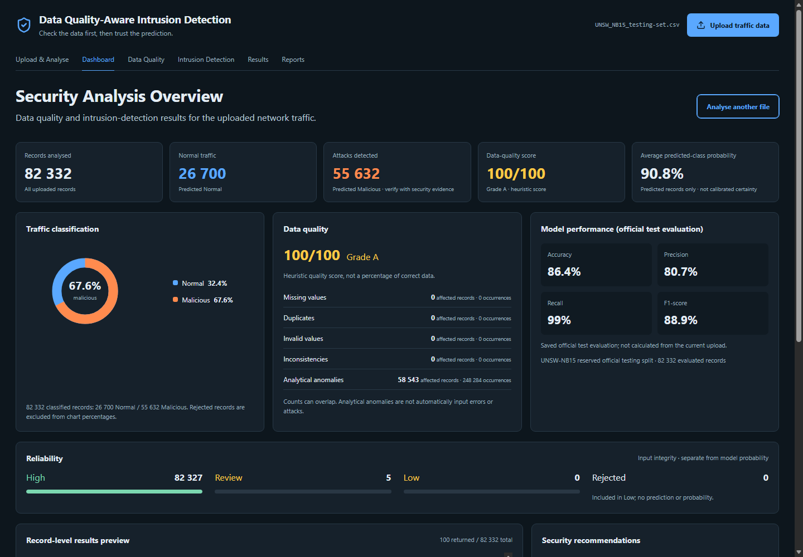
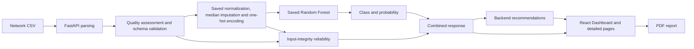

<div align="center">


# DataQualiQ

**Data Quality-Aware Network Intrusion Detection**

Check the data first, then interpret the prediction.

React · FastAPI · Python · scikit-learn · Random Forest

[](https://github.com/NokubongaVee/DataQualiQ/actions/workflows/ci.yml)

[Run locally](#run-locally) · [Architecture](#system-architecture) · [Verified results](#verified-results) · [Final report](#documentation-and-report)

</div>

## Project overview

DataQualiQ is a cybersecurity decision-support prototype that assesses uploaded network traffic CSVs, validates predictive inputs and applies a saved Random Forest to classify valid records as **Normal** or **Malicious**. Predictions include model probabilities and separate input-integrity explanations. Backend recommendations help analysts decide what to investigate.

The intended user group includes university IT security analysts and network administrators. The prototype was evaluated using UNSW-NB15; no university deployment or live monitoring is claimed. It analyses uploaded records and does not capture packets, automatically block traffic or change firewall rules.

**Author:** Victoria Nokubonga Mnisi ([NokubongaVee](https://github.com/NokubongaVee))

**Institution:** Sol Plaatje University, Department of Computer Science & Information Technology

**Status:** Completed academic prototype with recorded system validation and a controlled data-quality experiment.

## Interface



Actual Phase 15 capture after analysing the entire official testing CSV. Dataset-level summaries cover all 82,332 records; record details show only the returned window. Official evaluation metrics are labelled separately from current-upload summaries.

The interface provides Upload & Analyse, Dashboard, Data Quality, Intrusion Detection, Results and Reports. Results supports page-local filters and specific reliability/rejection reasons. Reports exports a bounded PDF from the active result.

## System architecture



- **Classification:** supervised Random Forest, 100 trees, maximum depth 20, minimum split 10, minimum leaf 2, sqrt feature sampling, bootstrap enabled and seed 42.
- **Preprocessing:** training-fitted medians and saved categorical vocabulary, producing 197 sparse encoded features from 42 predictors. No upload-time fitting, scaling or outlier removal.
- **Reliability:** High means no qualifying predictive-input integrity issue; Review identifies handled missingness, unseen categories or relevant findings; Low means rejected input with no prediction/probability.
- **Quality:** existing completeness, duplicate, validity, consistency and analytical checks. IQR anomalies are review evidence, not the intrusion classifier or automatically corrupt inputs.
- **State:** full active response stays in React memory; guarded session-storage writes persist only a small summary. Refresh requires a new upload for detailed results.

Model probability does not determine input reliability. The dataset score is a heuristic quality measure, not prediction accuracy.

## Run locally

Use **Python 3.13** and **Node.js 24**. The repository includes the verified saved model/preprocessor and official training/testing CSVs. Upload inference does not require retraining. Dependency versions in `backend/requirements.txt` match the saved bundle; incompatible scikit-learn versions are rejected.

From the project root in Windows PowerShell, start the backend:

```powershell
py -3.13 -m venv backend/venv
.\backend\venv\Scripts\python.exe -m pip install -r backend/requirements.txt
cd backend
.\venv\Scripts\python.exe -m uvicorn main:app --host 127.0.0.1 --port 8000
```

In a second terminal, from the project root:

```powershell
cd frontend
npm.cmd ci
npm.cmd run dev -- --host localhost --port 5173
```

Open **http://localhost:5173**. Backend API documentation: **http://127.0.0.1:8000/docs**.

Linux/macOS backend: `python3.13 -m venv backend/venv`, install with `backend/venv/bin/python -m pip install -r backend/requirements.txt`, then run `venv/bin/python -m uvicorn main:app --host 127.0.0.1 --port 8000` from `backend`. Frontend uses `npm ci` and `npm run dev` from `frontend`.

`frontend/.env.example` documents `VITE_API_BASE_URL`. Copy it to `.env` only when changing the backend URL and restart Vite. Virtual-environment activation is optional when invoking its Python executable directly; start Vite with `npm run dev`, not `dev` alone.

## Upload and API contract

A compatible file must contain the 42 saved predictive feature names. `id`, `label` and `attack_cat` are not required for inference. The exact schema and encoded order are in [model metadata](backend/models/model_metadata.json). CSV uploads are limited to **50 MiB**.

| Endpoint | Purpose |
|---|---|
| `POST /assess` | Independent data-quality assessment |
| `POST /predict-network` | Saved-model prediction |
| `POST /analyze-network` | Combined quality, prediction, reliability and recommendations |

Example from the project root:

```powershell
curl.exe -F "file=@data/UNSW_NB15_testing-set.csv" "http://127.0.0.1:8000/analyze-network?offset=0&limit=100"
```

The combined response separates `data_quality`, `intrusion_summary`, `model_performance`, `reliability_summary`, `records`, `pagination` and `recommendations`. Summaries cover the file; records are bounded to the requested window (default 100, maximum 1,000). Inference uses batches of at most 4,096. There is no reusable analysis-ID store; another window requires reupload/reanalysis. See the [API contract](docs/phase9/README.md).

## Verified results

### Official test evaluation

Both candidates used the same 82,332 labelled UNSW-NB15 testing records. Malicious is the positive class.

| Metric | Decision Tree | Selected Random Forest |
|---|---:|---:|
| Accuracy | 87.0221% | 86.4111% |
| Precision | 82.8576% | 80.6874% |
| Recall | 96.3668% | 99.0206% |
| F1 | 89.1031% | 88.9188% |
| False positives | 9,038 | 10,744 |
| False negatives / missed attacks | 1,647 | 444 |

Random Forest was selected using a declared recall-weighted F2 criterion. It missed 1,203 fewer attacks but produced 1,706 more false alarms. Decision Tree had better accuracy, precision and F1. Selection used this test split, so it is not a fresh independent estimate of the selected winner. [Exact evaluation and rationale](docs/phase5/README.md).

### Data-quality experiment

The fixed saved model was evaluated at 5%, 10% and 20% numeric missingness, categorical missingness and supported formatting changes. Missingness reduced accuracy, precision and F1 while slightly increasing recall. Categorical missingness affected performance most; formatting normalization preserved every baseline prediction. Effects are mechanism-dependent, not evidence that poor data always increases missed attacks. [Full Phase 16 results and plots](docs/phase16/README.md).

### Whole-system verification

Recorded Phase 15 validation: **28/28 end-to-end scenarios**, **274 backend tests**, **49 frontend tests**, lint and production build passed. Phase 16 subsequently recorded **282 backend tests**, including eight experiment tests. These are phase-specific evidence records, not claims that browser tests run on every device.

The complete testing CSV returned 26,700 Normal and 55,632 Malicious predictions, quality 100/A, 82,327 High, 5 Review and no rejected rows. Recorded processing time was about **239.5 seconds**. [Validation evidence](docs/phase15/README.md).

## Testing

From `backend`:

```powershell
.\venv\Scripts\python.exe -B -m unittest discover -p "test_*.py"
```

From `frontend`:

```powershell
npm.cmd test
npm.cmd run lint
npm.cmd run build
```

GitHub Actions runs both regression suites, lint and build. Optional real-browser audits require Windows, Microsoft Edge, Node 24 and the backend virtual environment; see [frontend instructions](frontend/README.md). Tests may train small isolated fixtures; uploaded traffic and the saved production artifacts are never fitted during inference.

## Repository layout

```text
backend/                 FastAPI, quality engine, domain validation and tests
backend/ml/              Training, preprocessing, evaluation and saved inference
backend/models/          Verified forest, preprocessor and versioned metadata
backend/experiments/     Fixed-model degradation experiment and plots
frontend/                React interface, API client and PDF export
 data/                   Official UNSW-NB15 training/testing CSVs
 docs/phase2–phase17/     Available phase reports and recorded evidence
 docs/final-report/      Capstone Word report, narrative and report evidence
```

Virtual environments, node_modules, builds, private uploads, credentials and local editor/tool configuration are excluded by `.gitignore`.

## Documentation and report

- [Final academic documentation](docs/phase17/README.md)
- [Stage 4 presentation summary](docs/phase17/stage4_summary.md)
- [Capstone final report — Word](docs/final-report/DataQualiQ_Capstone_Final_Report_Victoria_Mnisi.docx)
- [Capstone report — readable text](docs/final-report/DataQualiQ_Capstone_Final_Report.md)
- [Backend setup and phase workflows](backend/README.md)
- [Frontend setup and behavior](frontend/README.md)
- [Verified exported analysis PDF](docs/phase15/DataQualiQ-network-report.pdf)

The Word report includes the supplied student details and submission date. Final Word pagination and institutional similarity checking remain submission tasks; no similarity clearance is claimed. Earlier generic-interface architecture/evaluation notes remain labelled historical.

## Limitations

This is an academic decision-support prototype, not production network protection. Evaluation is primarily UNSW-NB15; new-network and temporal generalization are unverified. Probability is uncalibrated, input integrity does not guarantee correct predictions and false alarms/missed attacks remain. Large files are slow. Results and PDF previews are page-local, evidence may be truncated and full results are lost on refresh. The experiment uses one seed per mechanism, limited predictor groups and no uncertainty intervals or combined corruption condition. Production authentication, durable job storage and throughput guarantees are not claimed.

## Dataset attribution

The included CSVs are the official UNSW-NB15 training/testing partitions: 175,341 and 82,332 rows. They are benchmark data, not private university traffic. See [dataset provenance](data/README.md), [the official UNSW dataset page](https://research.unsw.edu.au/projects/unsw-nb15-dataset) and the authors' usage/citation terms.

Moustafa, N., & Slay, J. (2015). UNSW-NB15: A comprehensive data set for network intrusion detection systems (UNSW-NB15 network data set). *2015 Military Communications and Information Systems Conference (MilCIS).* https://doi.org/10.1109/MILCIS.2015.7348942
