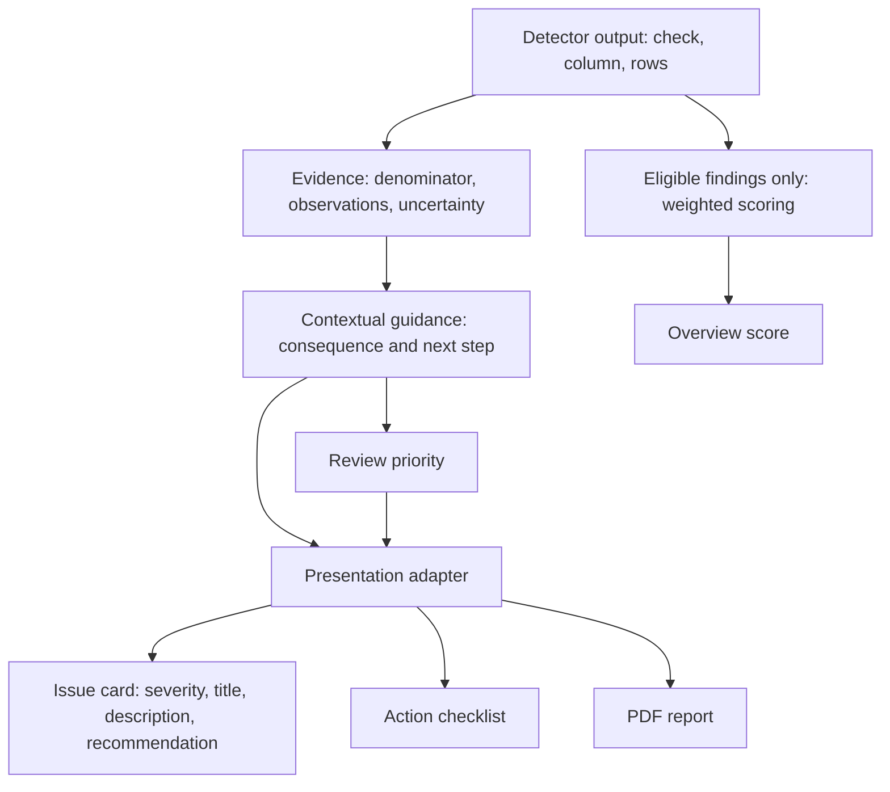

# Earlier generic assessment architecture and design rationale

> Historical scope: this document records the earlier generic data-quality application. The completed network intrusion-detection architecture, saved inference and memory-only active results are documented in [Phase 17](phase17/README.md#4-final-architecture) and the [current project README](../README.md).

## System boundary

DataQualiQ is a local two-process application. React renders the interface and FastAPI assesses CSV files. The browser sends a multipart upload, receives JSON, stores the result for the browser session, and generates a PDF on request. No database, external AI service, or automatic correction service is required.

## Backend modules

| Module | Responsibility |
| --- | --- |
| `main.py` | Upload boundary, extension/size checks, HTTP errors, health routes, worker-thread dispatch. |
| `csv_loading.py` | Decode supported text, infer supported delimiters, reject inconsistent row widths and duplicate/blank headers, preserve original strings. |
| `pipeline.py` | Coordinate profiling, checks, relationships, evidence, guidance, scoring, and translation. |
| `profiling.py` | Measure missingness, uniqueness, representation patterns, and numeric distributions. |
| `type_inference.py` | Infer possible field roles and types using measured values and header signals; expose contradictions and uncertainty. |
| `check_selection.py` | Select checks based on the observed field evidence. |
| `generic_checks.py`, `validity_checks.py` | Detect completeness, duplication, representation, and validity findings. |
| `anomaly_detection.py` | Identify distribution-based numeric review candidates. |
| `relationships.py` | Inspect repeated identifiers, mappings, co-missingness, and missingness concentration with explicit analysis bounds. |
| `finding_evidence.py` | Attach counts, affected indices, populations, observations, questions, and limitations. |
| `dataset_context.py` | Produce conservative vocabulary-based domain hypotheses. |
| `contextual_guidance.py` | Add plain-language consequences and actions; refine contact and age review priorities from available field context. |
| `scoring.py` | Calculate the legacy weighted score and explain penalties. |
| `recommendation_policy.py`, `translator.py` | Produce consistent review, recommendation, and compatibility response structures. |

## Finding flow

Evidence remains available in the API and PDF even though the main issue card intentionally omits expandable evidence sections. This keeps the interface focused while preserving inspectable findings.

## Frontend responsibilities

`App.jsx` selects the current view. Navigation helpers persist the selected page independently from the assessment result. `UploadPage.jsx` submits the CSV and handles errors. The dashboard pages consume the returned result; they do not rerun backend validation logic.

Reusable components implement navigation, upload interaction, the illustrative scan animation, issue cards, summary cards, charts, and recommended actions. Utility modules rank reviews, deduplicate overlapping affected-cell counts, and generate the PDF.

## Score versus review priority

The score begins at 100 and subtracts check-specific weighted penalties with affected-percentage modifiers. It is clamped at zero. Missing and format penalties avoid repeated penalties for the same field/check combination.

Review priority answers a different question: what should the user inspect first? It can consider contact alternatives or optional age information. These contextual priorities do not change the numerical score. New semantic and relationship candidates are excluded from the legacy penalty path in `pipeline.py`.

Neither signal is a probability of error or an assurance that data is fit for a high-stakes decision.

## Data lifecycle

| Location | Contents and lifetime |
| --- | --- |
| User filesystem | Original CSV; the application does not overwrite it. |
| API memory | Uploaded bytes, dataframe, profiles, and computed results during assessment. |
| Browser session storage | Returned assessment and last visited page. May include source examples. |
| Browser component state | Selected upload, loading state, and action completion during the active page session. |
| User downloads | PDF exported explicitly by the user. |

There is no authentication or multi-user persistence layer. CORS is configured for the local development frontend. Production hosting would require deliberate choices around origins, API configuration, upload abuse protection, authentication, retention, and observability.

## Tradeoffs and next steps

- Rules are inspectable and testable, but unfamiliar domains may need new evidence-backed rules or explicit user configuration.
- In-memory processing keeps the prototype simple, but a 50 MiB upload limit does not bound total dataframe memory use or guarantee interactive latency.
- Session storage makes refresh work, but large reports may exceed browser quotas and it does not provide durable history.
- Bounded relationship analysis controls work but may miss patterns outside the examined records or columns.
- The local API URL and Windows browser-test paths simplify development but require configuration for deployment or other environments.
- A future purpose/required-field confirmation step would let users refine review priority without pretending the CSV supplies every business rule.
