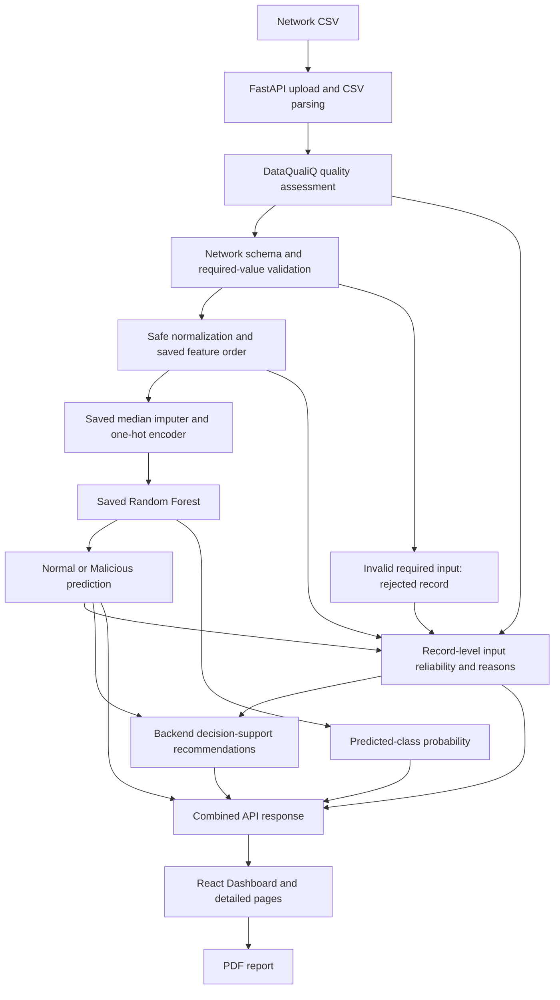

# DataQualiQ: Final Project Documentation

This document consolidates the completed Phases 1–16 for the academic report. [Stage 4 summary](stage4_summary.md) provides a shorter presentation outline. Phase 17 adds documentation only; it introduces no application changes, training or new evaluation.

## 1. Project Overview

DataQualiQ is a cybersecurity decision-support prototype for machine-learning-based network intrusion detection. A React interface submits network traffic CSVs to a FastAPI backend. The backend assesses input quality, validates network features, applies saved preprocessing and uses a saved Random Forest to classify records as **Normal (0)** or **Malicious (1)**. Predictions are accompanied by model probabilities, input-integrity explanations and recommendations for human investigation.

The application analyses uploaded traffic records; it does not capture live packets or automatically block traffic. Data quality supports interpretation of the intrusion classifier rather than replacing it.

## 2. Problem

Missing predictive values, invalid network fields and categories outside the training vocabulary can affect how a classifier interprets traffic. A predicted class or large probability alone does not reveal these input issues. Conversely, an unusual but valid traffic value may contain security evidence and should not automatically be removed as erroneous data. The engineering problem is to connect reliable input handling, reusable model inference and understandable security decisions.

## 3. Aim

Develop and evaluate an integrated network intrusion-detection prototype that preserves source records, serves a trained classifier through an API, exposes input-integrity evidence beside predictions and supports human security review. The research question is: **How does data quality affect the reliability of machine-learning-based network intrusion detection?**

## 4. Final Architecture

The accepted-record path proceeds through preprocessing and inference. Rejected records retain their original positions and reasons, with null class and probability; they do not enter the classifier. Reliability uses input evidence and prediction status, **not probability thresholds**.

| Stage | Role in the final system |
|---|---|
| Upload and parsing | Accept compatible CSVs up to 50 MiB; reject malformed files and preserve source values and row positions. |
| Quality assessment | Identify missing values, duplicates, invalid values, inconsistent representations and analytical anomalies; retain measured evidence and the existing heuristic score. |
| Network validation | Require the saved predictive schema. Missing required columns fail the request; invalid required values reject individual records in combined analysis. |
| Safe preprocessing | Apply saved normalization and feature order without learning from the upload, clipping values or removing outliers. |
| Saved imputation/encoding | Use training medians, an explicit missing-category indicator and the fitted one-hot vocabulary to produce the saved feature representation. |
| Saved classification | Apply Random Forest `predict` and `predict_proba`; no fitting occurs during uploads. |
| Probability | Return both class estimates and the estimate associated with the predicted class; this is separate from input integrity. |
| Reliability | Attach High, Review or Low status with specific input reasons and preserve rejected records. |
| Recommendations | Reuse backend priorities, messages, reasons and affected-record counts for human review and investigation. |
| Presentation/reporting | Display full-file summaries and bounded record evidence; export a PDF from the active result. |

`POST /analyze-network` combines these stages. `/assess` remains the independent quality endpoint; `/predict-network` remains the saved-model prediction endpoint. The combined response separates `data_quality`, `intrusion_summary`, `model_performance`, `reliability_summary`, `records`, `pagination` and `recommendations`. Official evaluation metrics are explicitly separate from current-upload summaries. See the [Phase 9 API contract](../phase9/README.md).

## 5. Algorithms

### Decision Tree baseline

The supervised Decision Tree baseline recursively splits labelled training examples using the **Gini impurity criterion**. Its verified configuration uses the best splitter, maximum depth 16, minimum split size 10, minimum leaf size 5 and `random_state=42`. It provides a practical single-tree comparison for the final ensemble.

### Random Forest classifier

The selected final model combines 100 decision trees trained on bootstrap samples, with randomized feature subsets at splits. This is the intrusion classifier; classification uses the estimator's saved decision rule.

| Parameter | Saved configuration |
|---|---|
| Trees | 100 |
| Split criterion | Gini |
| Maximum depth | 20 |
| Minimum samples to split | 10 |
| Minimum samples per leaf | 2 |
| Feature sampling | `sqrt` |
| Bootstrap | Enabled |
| Random seed | `random_state=42` |
| Class weighting | None |

Configurations are verified in [Phase 5](../phase5/README.md), [model factories](../../backend/ml/models.py) and [saved metadata](../../backend/models/model_metadata.json).

### Preprocessing

Numeric missing cells use **training-fitted median imputation**. Categorical missing cells use the reserved `__dataqualiq_missing__` indicator, kept distinct from valid categories. One-hot encoding reuses the saved vocabulary with `handle_unknown='ignore'`; a structurally valid unseen category becomes an all-zero category block and is audited for Review. Supported whitespace/case normalization is applied without inventing categories. No scaling, outlier removal or test/upload fitting is performed. Invalid required values are rejected rather than silently imputed as ordinary missingness.

## 6. Data Quality Layer

The existing generic quality engine supplies completeness, exact-duplicate, validity and consistency checks, together with profiling and bounded relationship analysis. Findings distinguish `data_error`, `quality_issue` and `analytical_security_anomaly`. The dataset score is a threshold-based heuristic, not the percentage of correct predictions or proof that records are trustworthy.

Numeric analytical anomalies use the **interquartile range (IQR)**: values outside `Q1 − 1.5 × IQR` and `Q3 + 1.5 × IQR` are candidates for contextual review, subject to the detector's safeguards. **IQR is not the intrusion classifier.** Analytical anomalies are not automatically confirmed attacks or corrupt inputs. Legitimate extreme values and duplicate records remain available to the model under the existing preservation policy. See [anomaly detection](../../backend/anomaly_detection.py) and the [Phase 8 policy](../phase8/README.md).

## 7. Machine Learning Pipeline

The official UNSW-NB15 training set contains **175,341 records**; the testing set contains **82,332 records**. The saved schema has **42 predictive features**: 39 numeric fields and `proto`, `service`, `state`. `id`, `attack_cat` and `label` are excluded from predictors and are not required for inference. Saved preprocessing produces **197 encoded features** in a fixed order.

Training and preprocessing fitting used the training population. Phase 6 packaged the selected estimator and fitted preprocessor as separate joblib artifacts, with versioned metadata, feature definitions and checksums. Serving loads the verified bundle and reuses `transform`, `predict` and `predict_proba`; upload requests never retrain or extend the vocabulary. See [Phase 6 persistence](../phase6/README.md) and [Phase 7 inference](../phase7/README.md).

Input-integrity rules remain independent of the model's probability:

| Reliability | Existing rule and interpretation |
|---|---|
| High | Prediction succeeded with no qualifying unresolved predictive-input issue. This is not a guarantee of correct classification. |
| Review | Prediction succeeded with a handled missing predictor, unseen category or relevant noncritical input finding. The explanation identifies the issue. |
| Low | Invalid required input prevented safe prediction. The record is rejected, with no fabricated class or probability. |

Rejected count is a subset of Low, not a fourth disjoint reliability category. Analytical anomalies and preserved duplicates do not automatically lower reliability under the default policy. Backend positions are zero-based original CSV data-row positions; the frontend displays them starting at one, excluding the header.

## 8. Model Comparison

These are the **verified Phase 5 official testing results**, evaluated on the same 82,332 records. Malicious is the positive class. Percentage values are rounded to four decimals; the [evaluation JSON](../phase5/evaluation.json) retains exact values.

| Measure | Decision Tree | Random Forest |
|---|---:|---:|
| Accuracy | 87.0221% | 86.4111% |
| Precision | 82.8576% | 80.6874% |
| Recall | 96.3668% | 99.0206% |
| F1 | 89.1031% | 88.9188% |
| Recall-weighted F2 | 93.3237% | 94.7164% |
| False positives | 9,038 | 10,744 |
| False negatives | 1,647 | 444 |
| Confusion matrix | `[[27962, 9038], [1647, 43685]]` | `[[26256, 10744], [444, 44888]]` |

Matrices use actual rows and predicted columns ordered [Normal, Malicious]: `[[TN, FP], [FN, TP]]`.

Random Forest was selected using the predeclared malicious F2 comparison, which emphasizes recall. It missed **1,203 fewer attacks**, at the cost of **1,706 additional false alarms**. Decision Tree had higher accuracy, precision and F1. Selection therefore reflects a stated cybersecurity tradeoff, not superiority on every metric. See [Phase 5 selection rationale](../phase5/README.md).

## 9. Final Model Evaluation — Official test evaluation

The selected Random Forest's **Official test evaluation** is the Random Forest column above, rather than a metric calculated for arbitrary uploads. Accuracy (86.4111%) measures overall correct classifications; malicious precision (80.6874%) measures how many Malicious predictions were actually malicious; recall (99.0206%) measures the fraction of actual malicious records detected; F1 (88.9188%) balances precision and recall.

The forest detected 44,888 malicious records and correctly classified 26,256 normal records. Its **444 false negatives are missed attacks**; its **10,744 false positives are normal records flagged as malicious**, creating investigation workload. High recall must therefore be interpreted alongside substantial false alarms. Probabilities are not calibrated confidence, and no operational false-alarm acceptance threshold was established.

The official testing split was used to compare and select the candidates. It is consequently **not a fresh independent estimate of the selected winner**, although test rows were not used to fit the candidates or preprocessing. This distinction applies to both the saved evaluation and the Phase 16 baseline.

## 10. Final Data Quality Experiment

[Phase 16](../phase16/README.md) assessed and predicted all 82,332 official testing rows for the original baseline and nine controlled degradations, using the same saved model and preprocessor. Labels, attack categories and original files were unchanged; selection did not use target labels. Sampling used nested prefixes at 5%, 10% and 20% of **original nonmissing predictor cells in each declared group**, not percentages of all rows or all features.

- Numeric missingness: `dur`, `rate`, `sbytes`; seed **16042**.
- Categorical missingness: `proto`, `service`, `state`; seed **16043**.
- Safe formatting inconsistency: outer whitespace on those categorical fields and uppercase `proto` only; seed **16044**. Case-sensitive `service` and `state` spelling was preserved.

No records were rejected in these safe-degradation conditions. Scores and metrics below are verified measurements; metrics are percentages.

| Condition | Quality score | Accuracy | Precision | Recall | F1 | FN |
|---|---:|---:|---:|---:|---:|---:|
| Baseline | 100 | 86.4111 | 80.6874 | 99.0206 | 88.9188 | 444 |
| Numeric 5% | 55 | 86.1901 | 80.4166 | 99.0360 | 88.7604 | 437 |
| Numeric 10% | 32.5 | 85.9605 | 80.1270 | 99.0735 | 88.5987 | 420 |
| Numeric 20% | 32.5 | 85.5062 | 79.5750 | 99.1176 | 88.2777 | 400 |
| Categorical 5% | 47.5 | 86.1475 | 80.3380 | 99.0934 | 88.7355 | 411 |
| Categorical 10% | 32.5 | 85.8512 | 79.9644 | 99.1441 | 88.5273 | 388 |
| Categorical 20% | 32.5 | 85.2937 | 79.2722 | 99.2389 | 88.1389 | 345 |
| Formatting 5% | 100 | 86.4111 | 80.6874 | 99.0206 | 88.9188 | 444 |
| Formatting 10% | 100 | 86.4111 | 80.6874 | 99.0206 | 88.9188 | 444 |
| Formatting 20% | 100 | 86.4111 | 80.6874 | 99.0206 | 88.9188 | 444 |

Changes below are **percentage points from baseline** for metrics and record counts for FN. Negative FN changes mean fewer missed attacks.

| Condition | Accuracy change | Precision change | Recall change | F1 change | FN change |
|---|---:|---:|---:|---:|---:|
| Numeric 5% | −0.2211 | −0.2707 | +0.0154 | −0.1584 | −7 |
| Numeric 10% | −0.4506 | −0.5603 | +0.0529 | −0.3201 | −24 |
| Numeric 20% | −0.9049 | −1.1124 | +0.0971 | −0.6412 | −44 |
| Categorical 5% | −0.2636 | −0.3494 | +0.0728 | −0.1834 | −33 |
| Categorical 10% | −0.5599 | −0.7230 | +0.1235 | −0.3915 | −56 |
| Categorical 20% | −1.1174 | −1.4151 | +0.2184 | −0.7799 | −99 |
| Formatting 5%, 10%, 20% | 0 | 0 | 0 | 0 | 0 |

**Categorical missingness affected performance most** at each matched level. At 20%, false positives rose from 10,744 to 11,763. Numeric missingness also reduced accuracy, precision and F1. Both mechanisms slightly increased recall and reduced false negatives; degradation did not invariably increase missed attacks.

Safe formatting changes produced identical prediction hashes and unchanged metrics because the existing preprocessing normalized the tested representations. This does not establish robustness to arbitrary corruption. Quality scores plateaued at 32.5 for 10% and 20% missingness while model metrics continued changing: quality score is not a calibrated forecast of classifier performance.

Detailed findings, reliability counts, confusion matrices and hashes are in the [measured CSV](../phase16/experiment_results.csv) and [complete JSON](../phase16/experiment_results.json). Report figures are available for [quality score](../phase16/plots/quality_score.png), [accuracy](../phase16/plots/accuracy.png), [recall](../phase16/plots/recall.png), [F1](../phase16/plots/f1.png) and [false negatives](../phase16/plots/false_negatives.png), each with an SVG version.

### Research question answer

Data quality affects the reliability of machine-learning-based intrusion detection through the specific input problem and the model's handling of it. In this experiment, missing predictors increased input Review counts and shifted the classifier toward more false alarms, reducing accuracy, precision and F1 while slightly improving recall. Supported formatting differences were normalized without changing predictions. Input integrity and predictive performance are related but distinct: neither a High reliability label nor a large probability guarantees correctness. The evidence supports a mechanism-dependent effect, bounded to the tested data, feature groups and saved classifier.

## 11. System Features

The completed system accepts compatible network CSVs, assesses quality, validates predictive fields, safely preprocesses inputs, classifies traffic, returns probabilities and attaches reliability reasons and backend recommendations. React exposes Upload & Analyse, Dashboard, Data Quality, Intrusion Detection, Record-Level Results and Reports. Reports exports a bounded PDF using the active analysis.

Malicious records with input issues and rejected records receive **High attention**; Malicious + High integrity receives **Security alert**; Normal + Review/Low receives **Normal review**. Rejected records take precedence and show their rejection reason rather than a fake prediction. Filters support All, Malicious, Normal, High, Review and Low on the **returned page only**. Recommendations support investigation using independent security evidence and correction of invalid inputs; there is no automatic blocking, firewall modification or isolation.

Inference processes at most 4,096 rows per batch and retains sparse feature matrices. The API returns a bounded window (default 100, maximum 1,000 records) plus full-file summaries, with bounded row evidence. `offset`, `limit` and page metadata describe that window. The frontend does not automatically fetch all pages. There is no reusable analysis-ID store; another window currently requires reupload/reanalysis. CSV parsing and quality assessment still process the full file, so bounded responses do not imply fully streaming ingestion.

The full active response lives in App memory across navigation. Only a small scalar summary and navigation state are safely persisted in browser session storage. Storage quota failures cannot convert successful backend analysis into failure. Refresh discards detailed results and shows a no-active-analysis message; a stored summary is explicitly historical and cannot reconstruct records or PDFs. See [Phase 10 integration](../phase10/README.md), [Phase 12 pages](../phase12/README.md) and [Phase 14 PDF](../phase14/README.md).

## 12. Verified Testing and Large-File Result

The following are **recorded Phase 15 results**, not new tests executed during this documentation phase:

| Verification | Recorded result |
|---|---|
| End-to-end scenarios | 28 tested, **28 passed, 0 failed** |
| Backend regression suite | **274 tests passed** |
| Frontend regression suite | **49 tests passed** |
| ESLint | Passed |
| Production build | Passed; existing large reporting-bundle advisory remains |

Real headless Edge sessions exercised React/Vite and FastAPI. Scenarios included malformed CSV, missing required features, missing cells, invalid numeric inputs, unseen categories, analytical outliers, duplicates, the full 82,332-row CSV, Dashboard and detailed pages, filtering, refresh and PDF export. Backend-unavailable and quota boundaries used deliberate mocks; successful CSV analyses and PDF exports used the real backend. This is automated browser verification with PDF-reader and visual inspection, not a claimed human manual session or universal device coverage.

The [Phase 15 validation report](../phase15/README.md), [scenario evidence](../phase15/system_validation.json) and [regression statuses](../phase15/regression_results.json) provide provenance. Phase 16 subsequently recorded 282 passing backend tests, including eight experiment tests; that later count does not replace the Phase 15 validation record.

### Verified full testing-file analysis

| Measure | Phase 15 observed value |
|---|---:|
| Rows analysed/predicted | 82,332 |
| Predicted Normal | 26,700 |
| Predicted Malicious | 55,632 |
| Quality | 100 / A |
| High reliability | 82,327 |
| Review | 5 |
| Low / rejected | 0 / 0 |
| Average predicted-class probability | 90.79% |
| Backend analysis time | 239.5 seconds |

Normal/Malicious counts above are **predictions**, not ground-truth class counts. Average predicted-class probability is not accuracy or calibrated confidence. The recorded exact mean is 0.9079187748526718 and time is 239.47992339998018 seconds. Concurrent regression work was active; this single hardware-dependent measurement is not a latency guarantee. The response returned 100 records, not 82,332 detailed rows; the serialized response was 149,930 bytes and persisted summary 266 bytes. Large-file processing time remains a practical limitation.

## 13. Limitations

- Training and evaluation are primarily UNSW-NB15; generalization to new networks, time periods and attack distributions is unverified.
- Compatible named predictive features are required; arbitrary CSV schemas cannot be classified safely.
- The application analyses uploaded records, without live packet capture or automatic network enforcement.
- Model probability is not calibrated confidence. Input reliability measures implemented integrity checks, not guaranteed correctness.
- False alarms and missed attacks remain; no agreed operational false-alarm cost or production acceptance criteria were established.
- Large-file quality assessment is slow. CSV parsing is not fully streaming, and multiuser throughput/peak memory were not comprehensively profiled.
- Bounded responses lack reusable analysis IDs. Another record window requires reupload/reanalysis; filters and important-record PDF previews cover only the returned page. Evidence may be truncated.
- Refresh loses full in-memory results; stored summaries cannot restore detailed findings or report exports.
- Phase 16 uses one seed per mechanism, correlated nested levels and limited degraded feature groups. No uncertainty intervals, combined degradation condition or systematic collection-failure experiment were included.
- The official test split previously participated in model selection, limiting claims of independent evaluation. No model was tuned using degraded outcomes.
- Automated responsive checks do not establish coverage of every browser/device. The existing bundle-size advisory and PDF font limitations remain.

## 14. Computer Science Contribution

The contribution combines supervised network intrusion detection, a reusable preprocessing/inference pipeline and backend model-serving architecture with a frontend cybersecurity decision-support system. Schema validation, immutable source-position mapping, bounded batching/responses, API contracts and safe state handling make model outputs usable across the interface. Integrating input-quality evidence with predictions provides explainable review decisions, while the controlled experiment evaluates how specific input failures change classifier behavior. Data-quality statistics support this computational system; they are not its sole contribution.

## 15. Conclusion

DataQualiQ demonstrates a working cybersecurity intrusion-detection prototype that integrates data-quality assessment with saved Random Forest classification, input-integrity explanations and human decision-support recommendations. Verified system testing supports the implemented upload-to-report workflow. The controlled experiment shows that missingness and supported representation differences affect model behavior differently, including a false-alarm/recall tradeoff. These findings support the project within its evaluated scope, without claiming universal accuracy or production readiness.

## 16. Report and Presentation Screenshots

Use actual application captures with dataset/sample scope stated in captions. Existing assets are evidence from their recorded phases, not newly captured Phase 17 screenshots.

| Recommended screenshot | Existing reference or capture needed |
|---|---|
| Upload page | [Upload design capture](../upload-design/desktop.png); recapture the final responsive page if its layout differs. |
| Dashboard | [Phase 15 full-file Dashboard](../phase15/dashboard.png). |
| Data Quality page | No dedicated screenshot verified in the documentation; capture the current page with real active results. |
| Intrusion Detection page | No dedicated screenshot verified; capture current predictions, official evaluation and reliability together. |
| Record-Level Results page | No dedicated screenshot verified; capture a Review/rejected explanation and state that rows/filters are page-local. |
| Reports page | No dedicated page screenshot verified; capture the current report view and export control. |
| Exported PDF | [Verified full-analysis PDF](../phase15/DataQualiQ-network-report.pdf) and [rendered first page](../phase15/page-1.png). Additional rendered pages are recorded in Phase 15. |

Older generic-interface images under `docs/images` are documented as earlier synthetic demonstrations and should not be presented as the final cybersecurity interface. See the [image provenance notes](../images/README.md).

## 17. Evidence Sources

- [Phase 5](../phase5/README.md): candidate comparison, exact evaluation JSON and selection rationale.
- [Phase 6](../phase6/README.md), [Phase 7](../phase7/README.md): saved artifacts, schema and inference safeguards.
- [Phase 8](../phase8/README.md), [Phase 9](../phase9/README.md): combined analysis, reliability policy, API sections and backend recommendations.
- [Phase 10](../phase10/README.md), [Phase 11](../phase11/README.md), [Phase 12](../phase12/README.md): memory/storage integration, Dashboard and detailed pages.
- [Phase 14](../phase14/README.md), [Phase 15](../phase15/README.md): report export and whole-system verification.
- [Phase 16](../phase16/README.md): controlled experiment, exact results, plots and source/artifact integrity checks.

No `docs/phase13` directory was available for this consolidation. Recommendation/attention behavior was instead verified against [backend recommendations](../../backend/ml/analysis_response.py), [frontend recommendation rendering](../../frontend/src/components/NetworkRecommendations.jsx), [record attention](../../frontend/src/components/RecordAttention.jsx) and the later Phase 14/15 verification. No missing metrics or screenshot paths were invented.
